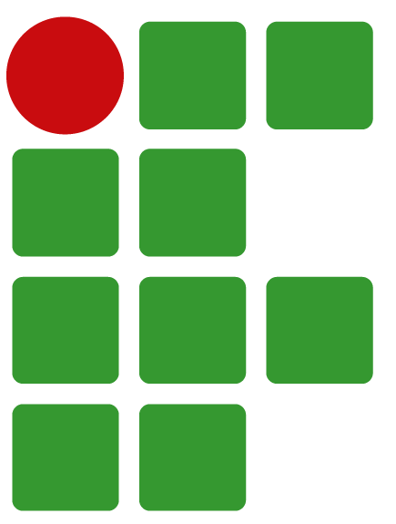

# Design System — Logo IFES / CEFOR

> **Objetivo deste arquivo:** dar a uma IA (ou a um dev) **todas as informações necessárias**
> para **gerar e aplicar a logo do CEFOR** em qualquer projeto HTML — sem depender de
> arquivos externos. A abordagem principal reproduz a marca em **CSS/HTML puro** (o
> "pixel-mark" do Instituto Federal). Também documentamos a versão em **PNG oficial**.

---

## 1. Contexto da marca

| Item | Valor |
|------|-------|
| Instituição | **IFES** — Instituto Federal do Espírito Santo |
| Unidade | **CEFOR** — Centro de Referência em Formação e em Educação a Distância |
| Assinatura completa | `INSTITUTO FEDERAL` / `Espírito Santo` / `Centro de Referência em Formação e em Educação a Distância` |
| Tipo de marca | Marca institucional dos Institutos Federais (padrão nacional) + lockup textual da unidade |
| Elemento gráfico | **Pixel-mark**: grade de quadrados verdes + 1 círculo vermelho no topo-esquerdo |

A marca segue o **manual de identidade visual da Rede Federal**: quadradinhos verdes que
formam, em negativo, as letras **"I" e "F"** (Instituto Federal), com um **círculo vermelho**
substituindo o primeiro quadrado (canto superior esquerdo).

---

## 2. Paleta de cores oficial

Use **exatamente** estes valores. O verde e o vermelho são as cores obrigatórias da marca.

```css
:root{
  /* Cores da MARCA (obrigatórias) */
  --cefor-green:      #3da63d;  /* verde principal dos quadrados */
  --cefor-red:        #e2211c;  /* vermelho do círculo (dot) */

  /* Verdes de apoio (UI, tons derivados) */
  --cefor-green-600:  #2e8b30;
  --cefor-green-700:  #1f7027;
  --cefor-green-800:  #16531d;
  --cefor-green-tint: #eaf4ea;
  --cefor-red-700:    #b81812;

  /* Neutros do lockup textual */
  --cefor-ink:        #111111;  /* "INSTITUTO FEDERAL" e "Espírito Santo" */
  --cefor-ink-soft:   #1c1c1c;
  --cefor-muted:      #5c6660;  /* linha 3 (nome da unidade) */
}
```

| Token | Hex | Uso |
|-------|-----|-----|
| `--cefor-green` | `#3da63d` | Quadrados da marca |
| `--cefor-red` | `#e2211c` | Círculo (dot) superior esquerdo |
| `--cefor-ink` | `#111111` | Texto "INSTITUTO FEDERAL" |
| `--cefor-muted` | `#5c6660` | Nome longo da unidade (linha 3) |

> ⚠️ **Nunca** troque o verde por outro tom, nem o círculo vermelho por quadrado. A relação
> **verde + círculo vermelho** é o que identifica a Rede Federal.

---

## 3. Tipografia

| Linha | Fonte | Peso | Observação |
|-------|-------|------|------------|
| `INSTITUTO FEDERAL` (L1) | **Archivo** (fallback: sans-serif condensada / `system-ui`) | 800 | Caixa alta |
| `Espírito Santo` (L2) | Archivo / Hanken Grotesk | 600 | — |
| Nome da unidade (L3) | Hanken Grotesk / `system-ui` | 400–600 | Cor `muted`, 2 linhas |

Import (Google Fonts) — opcional, mas recomendado para fidelidade:

```html
<link rel="preconnect" href="https://fonts.googleapis.com">
<link rel="preconnect" href="https://fonts.gstatic.com" crossorigin>
<link href="https://fonts.googleapis.com/css2?family=Archivo:wght@600;700;800;900&family=Hanken+Grotesk:wght@400;500;600&display=swap" rel="stylesheet">
```

Se não puder carregar fontes externas, use `font-family: system-ui, "Segoe UI", sans-serif` —
a marca continua legível.

---

## 4. Anatomia do pixel-mark (a grade)

A marca é uma **grade 3 colunas × 4 linhas** (12 células). Cada célula é um quadrado; a
primeira é um **círculo vermelho**; **duas células ficam vazias** (transparentes) para desenhar
o formato das letras. Padrão exato:

```
Coluna →     C1        C2        C3
Linha 1   [● red]   [■ green] [■ green]
Linha 2   [■ green] [■ green] [   vazio ]
Linha 3   [■ green] [■ green] [■ green]
Linha 4   [■ green] [■ green] [   vazio ]
```

- **10 quadrados verdes** + **1 círculo vermelho** + **2 células vazias** = 12 células (mas
  são só 11 elementos visíveis; as vazias podem ser `visibility:hidden` ou `background:transparent`).
- Cantos dos quadrados levemente arredondados (`border-radius: ~14%`).
- O círculo é o **primeiro** elemento (canto superior esquerdo).

> Esta é a assinatura visual do IFES. **Reproduza a posição das células vazias exatamente** —
> elas formam o "recorte" das letras I/F.

---

## 5. Implementação A — CSS/HTML puro (RECOMENDADA)

Autossuficiente, sem imagens, escala com `--u` (tamanho do quadrado). **Cole isto em qualquer HTML.**

### 5.1 CSS

```css
/* ===== MARCA IFES/CEFOR — pixel-mark em CSS puro ===== */
.if-mark{
  --u: 14px;            /* tamanho de cada quadrado — ajuste para escalar a marca */
  --g: 3px;             /* espaçamento entre quadrados */
  display: grid;
  grid-template-columns: repeat(3, var(--u));
  grid-auto-rows: var(--u);
  gap: var(--g);
  flex: none;
}
.if-mark span{
  background: var(--cefor-green, #3da63d);
  border-radius: 2px;                       /* ~14% de 14px */
}
.if-mark span.dot{                          /* círculo vermelho (1ª célula) */
  background: var(--cefor-red, #e2211c);
  border-radius: 50%;
}
.if-mark span.empty{                        /* célula vazia (recorte das letras) */
  background: transparent;
}

/* ===== LOCKUP TEXTUAL ===== */
.brand-lockup{ display:flex; align-items:center; gap:15px; }
.lockup{ line-height:1.16; }
.lockup .l1{ font-family:"Archivo",system-ui,sans-serif; font-weight:800;
             font-size:1.18rem; letter-spacing:.005em; color:var(--cefor-ink,#111); }
.lockup .l2{ font-weight:600; font-size:.92rem; color:var(--cefor-ink-soft,#1c1c1c); margin-top:2px; }
.lockup .l3{ font-size:.74rem; color:var(--cefor-muted,#5c6660); margin-top:2px;
             line-height:1.25; }

/* Responsivo: encolhe a marca e oculta a linha longa no mobile */
@media (max-width:680px){
  .if-mark{ --u:10px; --g:3px; }
  .lockup .l1{ font-size:1rem; }
  .lockup .l3{ display:none; }
}
```

### 5.2 HTML (marca completa: símbolo + texto)

```html
<div class="brand-lockup"
     aria-label="Instituto Federal do Espírito Santo — Centro de Referência em Formação e em Educação a Distância (CEFOR)">
  <!-- Símbolo (grade 3×4). Ordem = leitura por linhas. -->
  <div class="if-mark" aria-hidden="true">
    <span class="dot"></span><span></span><span></span>
    <span></span><span></span><span class="empty"></span>
    <span></span><span></span><span></span>
    <span></span><span></span><span class="empty"></span>
  </div>
  <!-- Lockup textual -->
  <div class="lockup">
    <div class="l1">INSTITUTO FEDERAL</div>
    <div class="l2">Espírito Santo</div>
    <div class="l3">Centro de Referência em Formação<br>e em Educação a Distância</div>
  </div>
</div>
```

> A ordem dos 12 `<span>` **importa** — ela mapeia a grade linha a linha. Não reordene.

### 5.3 Só o símbolo (sem texto)

```html
<div class="if-mark" role="img" aria-label="Instituto Federal do Espírito Santo">
  <span class="dot"></span><span></span><span></span>
  <span></span><span></span><span class="empty"></span>
  <span></span><span></span><span></span>
  <span></span><span></span><span class="empty"></span>
</div>
```

### 5.4 Animação de entrada (opcional)

```css
.if-mark span{ animation: cefor-pop .5s cubic-bezier(.2,.9,.3,1.4) backwards; }
.if-mark span.empty{ animation: none; }
.if-mark span:nth-child(1){ animation-delay:.04s } .if-mark span:nth-child(2){ animation-delay:.09s }
.if-mark span:nth-child(3){ animation-delay:.14s } .if-mark span:nth-child(4){ animation-delay:.11s }
.if-mark span:nth-child(5){ animation-delay:.16s } .if-mark span:nth-child(7){ animation-delay:.18s }
.if-mark span:nth-child(8){ animation-delay:.23s } .if-mark span:nth-child(9){ animation-delay:.28s }
.if-mark span:nth-child(10){ animation-delay:.25s } .if-mark span:nth-child(11){ animation-delay:.30s }
@keyframes cefor-pop{ from{opacity:0; transform:scale(.2)} to{opacity:1; transform:scale(1)} }

/* Respeita usuários que preferem menos movimento */
@media (prefers-reduced-motion: reduce){ .if-mark span{ animation:none } }
```

---

## 6. Implementação B — Símbolo em SVG (escalável, 1 elemento)

Quando quiser um único elemento vetorial (favicon, e-mail, ou onde CSS-grid não convém).
Grade 3×4, quadrado = 100u, gap = 22u, canto = 14u.

```html
<svg width="120" height="160" viewBox="0 0 366 488" xmlns="http://www.w3.org/2000/svg"
     role="img" aria-label="Instituto Federal do Espírito Santo">
  <!-- Linha 1: círculo vermelho + 2 quadrados verdes -->
  <circle cx="61" cy="61" r="61" fill="#e2211c"/>
  <rect x="133" y="0"   width="122" height="122" rx="17" fill="#3da63d"/>
  <rect x="266" y="0"   width="122" height="122" rx="17" fill="#3da63d" transform="translate(-22,0)"/>
  <!-- Linha 2: 2 quadrados (3ª célula vazia) -->
  <rect x="0"   y="133" width="122" height="122" rx="17" fill="#3da63d"/>
  <rect x="133" y="133" width="122" height="122" rx="17" fill="#3da63d"/>
  <!-- Linha 3: 3 quadrados -->
  <rect x="0"   y="266" width="122" height="122" rx="17" fill="#3da63d"/>
  <rect x="133" y="266" width="122" height="122" rx="17" fill="#3da63d"/>
  <rect x="244" y="266" width="122" height="122" rx="17" fill="#3da63d"/>
  <!-- Linha 4: 2 quadrados (3ª célula vazia) -->
  <rect x="0"   y="399" width="122" height="122" rx="17" fill="#3da63d"/>
  <rect x="133" y="399" width="122" height="122" rx="17" fill="#3da63d"/>
</svg>
```

> Mantém o **mesmo padrão de células** da grade da Seção 4. Ajuste `viewBox`/coordenadas se
> quiser precisão pixel-perfect; o essencial é preservar o arranjo (círculo no topo-esquerdo,
> duas lacunas nas colunas 3 das linhas 2 e 4).

---

## 7. Implementação C — PNG oficial (quando os arquivos existirem)

O projeto original inclui os arquivos oficiais em `assets/`:

| Arquivo | Conteúdo |
|---------|----------|
| `assets/cefor-horizontal-cor.png` | Marca **horizontal** completa (símbolo + texto), colorida — ~2835×1135 px |
| `assets/icone_cefor-horizontal-cor.png` | **Só o ícone** (pixel-mark), colorido |

```html
<!-- Marca horizontal completa -->


<!-- Só o ícone -->

```

Use os PNGs quando quiser 100% de fidelidade oficial e os arquivos estiverem disponíveis no
projeto. Para projetos **novos/portáveis**, prefira a **Implementação A (CSS puro)**, que não
depende de assets.

---

## 8. Regras de uso (do's & don'ts)

**Faça ✅**
- Mantenha o **círculo vermelho** no canto superior esquerdo.
- Preserve as **2 células vazias** (colunas 3 das linhas 2 e 4).
- Use o verde `#3da63d` e o vermelho `#e2211c` exatos.
- Garanta **área de respiro** ao redor da marca (mínimo = 1 quadrado `--u` de margem).
- Forneça `aria-label` descritivo; marque o símbolo decorativo com `aria-hidden="true"`
  quando o texto ao lado já nomeia a instituição.

**Não faça ❌**
- Não troque o círculo por quadrado nem mude sua cor.
- Não altere a proporção da grade (sempre 3×4) nem o arranjo das lacunas.
- Não aplique gradientes, sombras ou contornos nos quadrados da marca.
- Não distorça (mantenha os quadrados **quadrados**: largura = altura = `--u`).
- Não coloque a marca sobre fundos que reduzam o contraste do verde/vermelho.

---

## 9. Tamanhos de referência

| Contexto | `--u` (CSS) | Altura aprox. do símbolo |
|----------|-------------|--------------------------|
| Barra de navegação (desktop) | `14px` | ~65px |
| Mobile / compacto | `10px` | ~47px |
| Favicon / ícone pequeno | `6px` | ~30px |
| Hero / destaque | `20px`+ | ~90px+ |

Altura do símbolo ≈ `4 × --u + 3 × --g`.

---

## 10. Checklist para a IA aplicar a marca

1. [ ] Declarar os tokens de cor da Seção 2 no `:root` (ou usar os fallbacks inline).
2. [ ] Importar Archivo + Hanken Grotesk (ou aceitar `system-ui`).
3. [ ] Colar o **CSS da Seção 5.1**.
4. [ ] Colar o **HTML da Seção 5.2** (marca completa) ou 5.3 (só símbolo).
5. [ ] Ajustar `--u` conforme o contexto (Seção 9).
6. [ ] Conferir a **ordem dos 12 spans** e as **classes `dot` / `empty`**.
7. [ ] Validar contraste e área de respiro (Seção 8).
8. [ ] (Opcional) Adicionar animação da Seção 5.4 com `prefers-reduced-motion`.

---

*Referência extraída de `index-cefor.html` (Calculadora de Carga Horária MOOC — IFES/CEFOR).
Cores, fontes e estrutura da marca fiéis à implementação em produção.*
